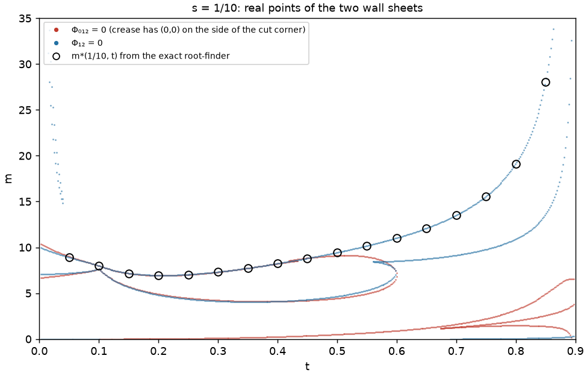

# Stability walls for labelled pentagons

*Crease space, a vertex formula for Donaldson's functional, and the wall as an algebraic hypersurface*

This note records a line of investigation, not a finished result. The question is whether the
Apostolov–Calderbank–Gauduchon criterion for labelled quadrilaterals has an analogue for pentagons.
We study one concrete two-parameter family of labelled pentagons, where the boundary between
relatively K-stable and unstable polygons can be computed exactly.

**Results, in brief.**

1. Donaldson's functional, evaluated on the simple crease with fold line $h = 0$, is a *piecewise
   rational function* of the coefficients of $h$.
   - The pieces are the chambers of an arrangement of lines in the dual projective plane: one line
     for each vertex of the polygon.
   - On each chamber the functional is a sum of explicit local contributions, one from each vertex
     on the positive side of the line (§4).
2. The functional is linear in the inverse labels. Stability along a line in label space is an
   interval, and the threshold is a Rayleigh-type quotient (§5).
3. The stability wall is contained in a discriminant: the locus where a family of plane curves in
   crease space acquires a singular point. Dually, it lies in the projective dual of a rational
   surface (§6).
4. In our family the threshold label $m^*$ is an algebraic number of degree 8 off the diagonal. The
   wall is cut out by one irreducible polynomial $\Phi(s,t,m)$ together with its mirror image
   $\Phi(t,s,m)$. On a slice we computed $\Phi$ exactly: it has degree 8 in $m$ but degree 72 in
   the shape parameter (§7).

Code: [research/pentagon_wall/](../research/pentagon_wall/). Conventions:
[CONVENTIONS.md](../CONVENTIONS.md).

---

## 1. Background

### 1.1 Toric extremal metrics and labelled polygons

A compact symplectic toric orbifold of real dimension 4 is determined by a *labelled polygon*
(Lerman–Tolman). This consists of a convex polygon

$$P = \lbrace x \in \mathbb R^2 : \ell_i(x) = \langle u_i, x\rangle - \lambda_i \ge 0,\ i = 1,\dots,n\rbrace,$$

with primitive inward normals $u_i \in \mathbb Z^2$, and a positive integer label $k_i$ on each edge. The
orbifold has cone angle $2\pi/k_i$ along the divisor over edge $i$; all $k_i = 1$ with $P$ Delzant is
the smooth case. Nothing below uses integrality, and we allow arbitrary positive real labels.

Toric Kähler metrics in a fixed Kähler class correspond to *symplectic potentials* (Guillemin, Abreu). These are
convex functions $u$ on the interior of $P$ with prescribed logarithmic singularities at the
boundary, which depend on the labels. In action–angle coordinates the metric is
$u_{ij}\,dx_i dx_j + u^{ij}\,d\theta_i d\theta_j$, and the scalar curvature is given by Abreu's formula

$$S(u) = -\tfrac12 \sum_{i,j} \frac{\partial^2 u^{ij}}{\partial x_i \partial x_j}.$$

The metric is *extremal* exactly when $S(u)$ is an affine function of $x$.

### 1.2 Donaldson's functional

Let $d\mu$ be Lebesgue measure on $P$. Let $d\sigma$ be the measure on $\partial P$ that is
$w_i = 1/k_i$ times the lattice-length measure on edge $i$. Equivalently, $d\ell_i \wedge d\sigma = k_i^{-1}\, d\mu$
up to sign. For a function $A$ on $P$, Donaldson's functional is

$$\mathcal L_A(f) = \int_{\partial P} f\, d\sigma - \int_P A f \, d\mu .$$

The basic identity is an integration by parts. For every symplectic potential $u$ in the class and
every smooth $f$,

$$\tfrac12 \int_P u^{ij} f_{ij}\, d\mu = \mathcal L_{S(u)}(f).$$

The boundary behaviour of $u$, and hence the labels, enters through the boundary term. Two
consequences:

- **The extremal affine function.** If $S(u) = A$ is affine, the identity with $f$ affine gives
  $\mathcal L_A(f) = 0$ for all affine $f$. This is three linear conditions on the three coefficients
  of $A$, so $A$ is the unique affine function with this property. It depends only on $(P, k)$ and is
  called $A_{\rm ext}$. From now on $\mathcal L = \mathcal L_{A_{\rm ext}}$, which vanishes on affine functions.
- **The obstruction.** If $u$ is extremal, then for every convex $f$
  $$\mathcal L(f) = \tfrac12 \int_P u^{ij} f_{ij}\,d\mu \ \ge\ 0,$$
  with equality only for affine $f$. The identity extends to continuous convex $f$, with $f_{ij}$ a measure.

The labelled polygon is *(relatively) K-stable* (toric, in Donaldson's sense) if $\mathcal L(f) > 0$ for every
convex, non-affine $f$. Existence implies stability by the computation above, and that is the only
direction used in this note. The converse is the deep part of the theory. In the smooth case it was
proved by Donaldson for constant scalar curvature metrics on toric surfaces, and by Chen–Li–Sheng
for extremal metrics on toric surfaces, in the uniform form. Apostolov–Calderbank–Gauduchon proved
it for labelled quadrilaterals by explicit construction.

### 1.3 Simple creases suffice

A *simple crease* is $f = \max(0, h)$, with $h$ affine and the line $h = 0$ meeting the interior of $P$.
In dimension 2, testing convex functions reduces to testing simple creases. Donaldson proved this for
positive $A$; Wang and Zhou proved it for every affine $A$, including the extremal case. So

$$P \text{ is stable} \iff \mathcal L(\max(0,h)) > 0 \text{ for every line } h = 0 \text{ crossing } P.$$

Stability is therefore a question about a function on a two-dimensional space of lines. A crease is
*balanced* if $\mathcal L(\max(0,h)) = 0$, and at a stability threshold the minimizing crease is balanced.

### 1.4 Quadrilaterals: the ACG criterion

For labelled quadrilaterals, Apostolov, Calderbank and Gauduchon (*Ambitoric geometry II*) construct
the candidate extremal metric explicitly. They show that stability need only be tested on two kinds of creases:

- the creases along the two diagonals;
- the creases along a one-parameter family of lines attached to a conic determined by the labelled
  quadrilateral.

So the two-dimensional search collapses to a curve plus two points. **The question behind this note:
is there a comparable reduction for pentagons?** A pentagon has no ambitoric structure, so any such
reduction would have to come from somewhere else.

---

## 2. The family

The fan of $\mathbb{CP}^2 \# 2\overline{\mathbb{CP}}{}^2$ has inward normals $(1,0), (0,1), (-1,0), (-1,-1), (0,-1)$. The
polygons with this fan are, up to translation and scale,

$$P(s,t):\quad x \ge 0,\ \ y \ge 0,\ \ x \le 1-s,\ \ x + y \le 1,\ \ y \le 1 - t, \qquad s,t > 0,\ s + t < 1.$$

This is the unit simplex with the corners at $(1,0)$ and $(0,1)$ cut off, with sizes $s$ and $t$. The
vertices are

$$v_0 = (0,0),\ v_1 = (1-s, 0),\ v_2 = (1-s, s),\ v_3 = (t, 1-t),\ v_4 = (0, 1-t).$$

Edge $i$ joins $v_i$ to $v_{i+1}$. The *hypotenuse*, edge 2, lies on $x + y = 1$ and has lattice length $1-s-t$.

**Labels.** The edge weights are $w = (1,1,m,1,1)$, so $d\sigma$ is $m$ times lattice length on the
hypotenuse. In terms of labels this is $(1,1,1/m,1,1)$. Rescaling all labels at once rescales $d\sigma$,
$A_{\rm ext}$ and $\mathcal L$ by the same constant, so it is equivalent to labels $(m,m,1,m,m)$: an orbifold
with cone angle $2\pi/m$ along four of the five divisors.

**Boundary and symmetry.**
- $s = 0$ or $t = 0$ is a labelled quadrilateral, where ACG applies. $s = t = 0$ is the triangle.
- The reflection $x \leftrightarrow y$ maps $P(s,t)$ to $P(t,s)$. It preserves the labels and swaps
  $v_1 \leftrightarrow v_4$ and $v_2 \leftrightarrow v_3$.

**What the computation shows.** The exact crease minimum from `crease_exact.crease_minimum` was
computed on the grid $s, t \in \tfrac1{20}\mathbb Z$. On that grid:

| $m$ | 6 | 7 | 8 | 10 | 12 | 16 |
|---|---|---|---|---|---|---|
| % of grid unstable | 0 | 14 | 30 | 51 | 64 | 80 |

- **Instability needs $m$ large.** At $m = 7$ the unstable set is an island inside the triangle, and it grows with $m$.
- **The threshold** $m^*(s,t)$ is the label at which $P(s,t)$ becomes unstable; it is computed by root-finding on the exact crease minimum.
- **The diagonal.** On $s = t$ the balanced crease is the symmetry axis $\max(0, x - y)$, and
  $$m^*(s,s) = \frac{8s^6 - 8s^5 - 4s^4 + 12s^3 - 8s^2 + 1}{2s(1-s)^3(1-2s)} = \frac1{2s} + \frac52 + 4s + O(s^2).$$
  This was checked exactly at 50 rational points. Its minimum is $m_0 \approx 6.2246388$, attained at
  $s_0 \approx 0.2160822$, where $s_0$ is a root of a polynomial of degree 8. The grid's smallest $m^*$ lies on the diagonal, so $m_0$ is presumably where instability is born.
- **The corners are stable.** As $s, t \to 0$ the threshold tends to infinity, roughly like $1/(2s)$
  along the diagonal. This is consistent with an orbifold, weighted version of the
  Arezzo–Pacard–Singer theorem on blow-ups of extremal metrics. Here the corners are
  $\mathbb Z_m$-orbifold points and the cuts are weighted blow-ups.
- **The side $s = 0$.** The exact thresholds agree with ACG's criterion to relative $10^{-6}$–$10^{-5}$. ACG's
  is implemented independently in `ambitoric.py`; the residual comes from sampling its conic.
- **No obvious simple structure.**
  - No power $(m^*)^{-p}$ with $p \in [1/4, 3/2]$ is concave on the grid.
  - The balanced creases of the pentagons do not lie on the obvious conics in line space. Two
    candidates were tested: the conic through the five edge lines, and ACG's conic for the
    quadrilateral obtained by deleting one edge. The residuals were $10^{-2}$–$10^{-1}$.

---

## 3. Crease space

Write $h_c(x) = c_0 + c_1 x_1 + c_2 x_2$ for $c = (c_0,c_1,c_2) \in \mathbb R^3$. Set

$$f_c = \max(0, h_c), \qquad \mathbb L(c) = \mathcal L(f_c).$$

Three elementary properties:

- **Homogeneity.** $\mathbb L(\lambda c) = \lambda\, \mathbb L(c)$ for $\lambda > 0$.
- **Evenness.** $\mathbb L(-c) = \mathbb L(c)$, because $f_c - f_{-c} = h_c$ is affine and $\mathcal L$ kills affine functions.
- **Trivial zeros.** $\mathbb L(c) = 0$ when the line $h_c = 0$ misses the interior of $P$, since then $f_c$ is affine on $P$.

So the sign of $\mathbb L$ is a function on lines. Oriented lines are rays in $\mathbb R^3$, which form a
sphere $S^2$. Forgetting the orientation identifies $c$ with $-c$, giving the dual projective plane
$\mathbb{RP}^{2*}$; our function lives on the double cover $S^2 \to \mathbb{RP}^{2*}$.

The lines missing $P$ correspond to $\pm$ the interior of the polar polygon

$$P^\circ = \lbrace [c] : h_c \ge 0 \text{ on } P\rbrace = \bigcap_{v \text{ vertex}} \lbrace h_c(v) \ge 0\rbrace.$$

So **crease space** $\mathcal C = \mathbb{RP}^{2*} \setminus P^\circ$ is a Möbius band, the classical
space of lines meeting a convex body. Stability means $\mathbb L > 0$ on $\mathcal C$.

**Vertex lines and chambers.** For each vertex $v$, the lines through $v$ form a line $v^* = \lbrace h_c(v) = 0\rbrace$ in
$\mathbb{RP}^{2*}$. The polar polygon is bounded by these $n$ lines. The other chambers of the
arrangement are the combinatorial types of creases. Each is labelled by the set
$S = \lbrace v : h_c(v) > 0\rbrace$, up to replacing $S$ by its complement, which corresponds to $c \mapsto -c$.

---

## 4. A vertex formula for $\mathbb L$

For a vertex $v$, write:
- $v', v''$ for its two neighbours, and $e' = v' - v$, $e'' = v'' - v$ for the edge vectors (actual vectors, not primitive ones);
- $\sigma', \sigma''$ for the $\sigma$-masses of the two edges at $v$;
- $\delta' = h_c(v') - h_c(v)$ and $\delta'' = h_c(v'') - h_c(v)$, which are linear forms in $(c_1, c_2)$;
- $\beta' = A(v') - A(v)$ and $\beta'' = A(v'') - A(v)$, where $A = A_{\rm ext}$.

**Proposition.** On the chamber where $\lbrace v : h_c(v) > 0\rbrace = S$,
$$\mathbb L(c) = \sum_{v \in S} \varphi_v(c),$$
where
$$\varphi_v(c) = -\frac{\sigma' h_c(v)^2}{2\delta'} - \frac{\sigma'' h_c(v)^2}{2\delta''}
- \frac{|\det(e', e'')|}{\delta'\delta''}\left( \frac{A(v)\, h_c(v)^3}{6} - \Big(\frac{\beta'}{\delta'} + \frac{\beta''}{\delta''}\Big)\frac{h_c(v)^4}{24}\right).$$

*Proof sketch.*
- Apply Brion's formula
  $\int_Q e^{\langle \xi, x\rangle} dx = \sum_{v} e^{\langle \xi, v\rangle}\,|\det(e',e'')| / (\langle\xi,e'\rangle\langle\xi,e''\rangle)$
  to the clipped polygon $Q = P \cap \lbrace h_c \ge 0\rbrace$.
- Replace $\langle\xi,x\rangle$ by $\tau h_c(x) + \varepsilon\,(A(x) - A(0))$ and extract the coefficient
  of $\tau^1$, together with $\varepsilon^0$ and $\varepsilon^1$.
- The new vertices of $Q$ lie on $h_c = 0$, so their terms contribute only negative powers of $\tau$
  and drop out. The vertices of $P$ in $S$ keep their tangent cones.
- The boundary term is the one-dimensional case of the same formula, applied to each edge.

This is a Lawrence-type, or "truncated power", formula.

The formula is verified exactly in `research/pentagon_wall/creasealg.py`. It is checked against direct
integration (`Polygon.L_crease`) at about 400 random creases on four random pentagons of the family, and the difference is
identically zero. Consequences:

1. **The double cover again.** $\sum_{\text{all } v} \varphi_v = \mathcal L(h_c) = 0$ identically. So
   $\sum_{S}\varphi_v = -\sum_{S^c}\varphi_v$, which is exactly the identification of $c$ with $-c$.
2. **$C^1$ across chamber walls.** Each $\varphi_v$ is divisible by $h_c(v)^2$, so $\mathbb L$ is $C^1$
   across the walls $v^*$, though in general not $C^2$.
3. **Polynomial after clearing denominators.** The denominators are powers of the linear forms
   $\langle (c_1,c_2), e\rangle$, one for each edge direction $e$. Each such form vanishes on a line of
   $\mathbb{RP}^{2*}$ through $[1:0:0]$, the pencil of lines parallel to that edge. The chamber sums
   are continuous across these lines, so after multiplying by a fixed polynomial $D(c)$ each chamber
   gives a homogeneous polynomial
   $$N_S(c) = D(c) \sum_{v \in S} \varphi_v(c).$$
   For our family $D = c_1^2 c_2^2 (c_1 - c_2)^2$ and $\deg N_S = 7$. In practice the degrees are lower
   after cancellation: in the chart $c_1 = 1$, the relevant chambers give degree 4 in $c_0$ and 3–5 in $c_2$.
4. **Dependence on the shape and labels.** $A_{\rm ext}$ solves a $3\times 3$ linear system whose
   matrix is the second-moment matrix of $P$. The right-hand side is linear in the weights $w_i$. So
   $A_{\rm ext} = \operatorname{adj}(G)\,b/\Delta$, where $\Delta = \det G$ is a polynomial in the
   support numbers; for our family $\Delta(s,t)$ has degree 10. After clearing $\Delta$ too, $N_S$ is a polynomial in
   $(c, s, t, w)$. This is computed symbolically in `creasealg.py`, in a fraction of a second.

---

## 5. Linearity in the labels

Since $A_{\rm ext} = \sum_i w_i A_i$, where $A_i$ solves the moment equations with only edge $i$'s boundary measure,

$$\mathcal L = \sum_i w_i\, \mathcal L_i, \qquad \mathcal L_i(f) = \int_{E_i} f\, d\sigma_i^{(1)} - \int_P A_i f\, d\mu ,$$

where $d\sigma_i^{(1)}$ is the lattice-length measure on edge $E_i$. Each $\mathcal L_i$ kills affine functions. Consequences:

- **The stable set is a convex cone.** For a fixed shape, the stable weights form the open convex cone
  $\lbrace w : \sum_i w_i \mathcal L_i(f_c) > 0 \ \forall c \in \mathcal C\rbrace$, an intersection of half-spaces.
- **Along a line of weights, stability is an interval.** For our family,
  $\mathcal L = \mathcal L_{\rm rest} + m\,\mathcal L_{\rm hyp}$, so
  $$m^*(s,t) = \inf\Big\lbrace \frac{\mathcal L_{\rm rest}(f_c)}{-\mathcal L_{\rm hyp}(f_c)} : c \in \mathcal C,\ \mathcal L_{\rm hyp}(f_c) < 0 \Big\rbrace.$$
  At every interior point of the $\tfrac1{20}$ grid, $P(s,t)$ is stable at $m = 4$ and unstable at $m = 2000$.
  So, by the interval property, it is stable on $[4, m^*)$ and unstable for $m > m^*$. On a coarser
  grid it is also stable for $m \le 1$.
- **The shape is a different matter.** Convexity in $w$ says nothing about convexity in $(s,t)$, and
  indeed the stable region in the shape parameters is not convex (§2).

The quotient defining $m^*$ is homogeneous of degree 0 in $c$, so it is a function on lines. Its
critical points do not involve $m$. For each shape there are finitely many critical lines, and $m^*$
is one of the critical values.

---

## 6. The wall as a discriminant

Fix the parameters $p = (s,t,m)$. By Euler's relation, $c\cdot\nabla \mathbb L = \mathbb L$ on each chamber.

- **The threshold is a critical point.** At the threshold, $\mathbb L \ge 0$ on $\mathcal C$ and
  vanishes at the balanced crease $c^*$. When $c^*$ lies in the interior of $\mathcal C$ (as it does in every
  case we computed) and $\mathbb L$ is $C^1$ there, $\nabla \mathbb L(c^*) = 0$.
- **Critical points are zeros.** Conversely, by Euler's relation every critical point of $\mathbb L$ is a zero.
- **In terms of $N_S$.** Where $\mathbb L = 0$, $\nabla N_S = D\,\nabla \mathbb L$. So, away from $D = 0$,
  the critical zeros of $\mathbb L$ are exactly the singular points of the plane curve
  $$Z_p = \lbrace N_S(\,\cdot\,; p) = 0\rbrace \subset \mathbb{P}^{2*}.$$

**The wall is contained in the discriminant locus of the family of plane curves $Z_p$.** Geometrically:

- For stable $p$, $Z_p$ has no real points in the relevant part of the chamber.
- At the wall, $Z_p$ acquires a real isolated singular point (an acnode) at the balanced crease.
  Generically this is a nondegenerate minimum of $\mathbb L$.
- Beyond the wall, the acnode opens into an oval bounding the disc of destabilizing creases.

The diagonal $s = t$ is non-generic: there the balanced crease passes through the vertex $v_0$, so it lies on a chamber wall.

**The dual picture.** For a fixed shape, consider the map
$$\Lambda : \mathcal C \to \mathbb P^{n-1}, \qquad c \mapsto [\mathcal L_1(f_c) : \dots : \mathcal L_n(f_c)].$$
It is rational on each chamber, with image a rational surface $\Sigma$, assembled from one piece per
chamber. A weight vector $w$ is stable iff the hyperplane $w^\perp$ meets $\Lambda(\mathcal C)$ only on its positive side.
So the stable cone is the dual of the cone over $\Sigma$, and **the wall in label space lies in the
projective dual variety $\Sigma^\vee$**. The threshold $m^*$ is a point where the line $w(m) = w_{\rm rest} + m\,e_{\rm hyp}$ meets
$\Sigma^\vee$. The degrees found below count such intersections.

---

## 7. Computations

All the computations are exact, in rational arithmetic with python-flint. Floating point is used only
to decide which factor of a polynomial contains a previously computed threshold. Those thresholds are
the ones in `notebooks/data/cp2_2_thresholds.json`, computed by `extremal.survey.thresholds`.

### 7.1 Fixed shape: $m^*$ has degree 8

**Method** (`research/pentagon_wall/wallpoly.py`). Fix rational $(s,t)$ and take the chamber $S$ of
the balanced crease. Work in the chart $c_1 = 1$, with unknowns $(c_0, c_2)$.
1. Write $N_S = N_{\rm rest} + m\,N_{\rm hyp}$ and remove the common factor of $N_{\rm rest}$ and $N_{\rm hyp}$.
2. Form the critical-point equations of the ratio:
   $E_a = N_{\rm rest}\,\partial_a N_{\rm hyp} - N_{\rm hyp}\,\partial_a N_{\rm rest}$ for $a = c_0, c_2$.
3. $\operatorname{Res}_{c_0}(E_{c_0}, E_{c_2})$ is a polynomial in the slope $c_2$. Factor it and keep the
   factor containing the balanced crease.
4. Take its resultant with $\operatorname{Res}_{c_0}(E_{c_0}, N_{\rm rest} + m N_{\rm hyp})$ to get a
   polynomial in $m$. The minimal polynomial of $m^*$ is one of its factors.

Each point takes about 0.5 s.

| $(s,t)$ | chamber $S$ | degree of $m^*$ over $\mathbb Q$ | agreement with root-finder |
|---|---|---|---|
| $(1/5, 1/5)$ | $v_0$ on the crease | 1: $\ 1920m - 11993 = 0$ | exact (the closed form) |
| $(1/10, 3/10)$ | $\lbrace v_0,v_1,v_2\rbrace$ | 8 | $5\cdot 10^{-11}$ |
| $(1/20, 1/2)$ | $\lbrace v_0,v_1,v_2\rbrace$ | 8 | $5\cdot 10^{-10}$ |
| $(1/20, 1/10)$, $(3/20, 1/5)$ | $\lbrace v_0,v_1,v_2\rbrace$ | 8 | $\approx 10^{-12}$ |
| $(1/5, 3/10)$, $(1/4, 1/2)$, $(1/10, 7/10)$ | $\lbrace v_1,v_2\rbrace$ | 8 | $\le 3\cdot 10^{-11}$ |

What these show:

- **Degree 8.** Off the diagonal, $m^*$ is algebraic of degree 8, and so is the slope of the balanced
  crease. On the diagonal the symmetry forces the critical line to be the axis, and $m^*$ is rational in $s$.
- **The other roots.** Typically the degree-8 polynomial has four real roots, which are critical values
  of other critical creases, and two complex pairs. Sometimes a second real root lies close to $m^*$:
  at $(1/20, 1/2)$ there are roots at $13.1765 = m^*$ and $13.1961$. Such near-coincidences are where the
  minimizing crease can jump.

### 7.2 Two chambers, two sheets

The balanced crease separates the cut corner $v_1v_2$ from the rest of the polygon. Depending on
$(s,t)$, the vertex $v_0$ lies on one side or the other, giving chamber $\lbrace v_0,v_1,v_2\rbrace$ or $\lbrace v_1,v_2\rbrace$.

- **The chambers give different algebraic numbers.** Applying one chamber's polynomial at a point of
  the other chamber gives a nearby but different number. For example, at $(1/5, 3/10)$ one gets
  6.45686 instead of $m^* = 6.45803$.
- **So $m^*$ is glued from two sheets.** They meet along the curve in the $(s,t)$-plane where the
  balanced crease passes through $v_0$. Since $\mathbb L$ is $C^1$ there, the gluing is tangential,
  and the kink is invisible to the eye.

### 7.3 The slice $s = 1/10$

Eliminating with $t$ symbolic produces large intermediate resultants: degree 68 in the slope and 126 in $t$.
Instead we interpolate (`wallsample.py`, `wallinterp.py`):

1. At about 200 rational values $t_k$, the fixed-shape computation gives the monic degree-8 polynomial of the critical value.
2. Then $\Phi(t,m) = \sum_{j \le 8} p_j(t)\, m^j$ is the solution of the linear system
   $p_j(t_k) = p_8(t_k)\, a_{j,k}$, where $a_{j,k}$ are the monic coefficients.
3. The degree in $t$ is found from the nullity of this system modulo the prime $2^{61}-1$. The kernel is
   then computed exactly over $\mathbb Q$, from the first ~90 samples.
4. The result is checked exactly at all 199 samples.

Because the degree in $t$ is minimal, $\Phi$ has no factor depending on $t$ alone. Every
specialization is irreducible of degree 8 in $m$. So $\Phi$ is irreducible in $\mathbb Q[t,m]$.

| sheet | degree in $m$ | degree in $t$ | terms | largest coefficient |
|---|---|---|---|---|
| $\Phi_{012}$ (chamber $\lbrace v_0,v_1,v_2\rbrace$) | 8 | 72 | 636 | 88 digits |
| $\Phi_{12}$ (chamber $\lbrace v_1,v_2\rbrace$) | 8 | 76 | 674 | 86 digits |

The leading coefficient of $\Phi_{012}$ in $m$ is

$$t^2\,(t-1)\,(10t-9)^4 \cdot q_{17}(t)^2 \cdot q_{27}(t),$$

up to a constant, with $q_{17}, q_{27}$ irreducible of degrees 17 and 27. At $s = 1/10$ the linear factors are the lattice
lengths of edges 3, 4 and 2: $t$, $1-t$ and $1-s-t = (9-10t)/10$. The leading coefficient vanishes when an edge collapses.

Every threshold $m^*(1/10, t)$ from the grid, for $t = 0.05, \dots, 0.85$, is a root of the sheet for
its own chamber, to within $10^{-12}$–$3\cdot 10^{-9}$. The other sheet misses by at least $8\cdot 10^{-4}$, except
at $t = 1/10$. That point is on the diagonal, where the balanced crease passes through $v_0$ and both sheets agree.



In the figure, the threshold follows the red sheet from the diagonal ($t = 1/10$) to about $t \approx 0.37$,
and the blue sheet elsewhere. Each sheet also has further real branches: critical values of creases that are not minimizers.

### 7.4 One polynomial

The reflection $x \leftrightarrow y$ maps $P(s,t)$ to $P(t,s)$. It sends chamber
$\lbrace v_0,v_1,v_2\rbrace$ to $\lbrace v_0,v_3,v_4\rbrace$, which is the complement of $\lbrace v_1, v_2\rbrace$. So we expect
$$\Phi_{12}(s,t,m) = \Phi_{012}(t,s,m).$$
This was checked exactly at three points: the monic polynomials of $\Phi_{012}(a, 1/10, \cdot)$ and
$\Phi_{12}(1/10, a, \cdot)$ coincide for $a = 7/41, 15/41, 30/41$.

**The whole wall is therefore one irreducible polynomial $\Phi(s,t,m)$ and its mirror image.** At each
$(s,t)$, $m^*$ is a root of $\Phi(s,t,\cdot)$ or of $\Phi(t,s,\cdot)$, according to the side of the
balanced crease on which $v_0$ lies. By the slice computation, $\Phi$ has degree 8 in $m$, 72 in $t$
and presumably 76 in $s$ (the degree of $\Phi_{12}$ in $t$).

---

## 8. Why the degrees are large, and open questions

The intrinsic complexity is small. Each pentagon gives a degree-8 problem: 8 critical lines and 8
critical values. The large degrees in $(s,t)$ come from two sources:

- **The coefficients.** $A_{\rm ext}$ is rational in the shape, with a denominator of degree 10, so $N_S$ has degree 12 in $t$.
- **The elimination.** $\Phi$ is the projection of a curve in crease space × parameter space to the
  parameter space, and degrees multiply under projection, roughly as in Bézout's theorem.

It is not clear that this is worse than for quadrilaterals. The simplicity of ACG's criterion lies in
*crease space*, a conic of test lines. It does not say that their wall is a low-degree equation in the
shape parameters. Questions:

1. **Calibration on quadrilaterals.** What is the degree in $t$ of the wall on the side $s = 0$, where
   ACG applies? If it is also in the dozens, then large degrees are simply what walls look like, even
   when an ACG-type criterion exists. This is a short computation with the same code applied to the quadrilateral.
2. **A curve of test lines.** Is there a low-degree curve in $\mathbb{RP}^{2*}$, depending simply on the
   labelled pentagon, that always contains the balanced crease? This would be the real analogue of
   ACG's conic. The exact degree-8 slope polynomials make the curve of balanced creases computable.
   The simplest conics fail (§2).
3. **The full surface $\Phi(s,t,m)$.** It is computable by the same interpolation, one slice per value
   of $s$, followed by reconstruction in $s$. That is a few hours of computation on a workstation.
4. **Jumps of the minimizer.** The minimizing crease can jump in two ways. One root of $\Phi(s,t,\cdot)$
   can overtake another; this happens on the discriminant of $\Phi$ in $m$. Or a root of
   $\Phi(s,t,\cdot)$ can cross a root of $\Phi(t,s,\cdot)$; this happens on the zero set of
   $\operatorname{Res}_m(\Phi(s,t,m), \Phi(t,s,m))$. Do these curves explain the kinks of $m^*$, in
   particular near the corner, where the symmetry axis competes with a pair of off-axis creases?
5. **The dual surface.** What are the degree and the singularities of $\Sigma \subset \mathbb P^4$ and of its dual
   $\Sigma^\vee$, for a fixed pentagon? For quadrilaterals, $\Sigma \subset \mathbb P^3$. Does ACG's conic
   appear there as a special feature of $\Sigma$?

---

## 9. Reproducing

From the repository root, with the venv active and python-flint installed:

```
python research/pentagon_wall/creasealg.py                        # vertex formula vs direct integration
python research/pentagon_wall/wallpoly.py 1/10 3/10               # m* at one shape: degree 8
python research/pentagon_wall/wallsample.py 0,1,2 1/10 1:201:41 out.json   # ~3 min on 19 cores
python research/pentagon_wall/wallinterp.py Phi out.json          # interpolate and verify Phi(t, m)
python research/pentagon_wall/check_slice.py research/pentagon_wall/data   # compare with thresholds, plot
```

The samples and the two polynomials at $s = 1/10$ are in `research/pentagon_wall/data/`.

## References

- M. Abreu, *Kähler geometry of toric varieties and extremal metrics*, Internat. J. Math. 1998.
- V. Apostolov, D. Calderbank, P. Gauduchon, *Ambitoric geometry II: extremal toric surfaces and Einstein 4-orbifolds*, Ann. Sci. ÉNS 2015.
- C. Arezzo, F. Pacard, M. Singer, *Extremal metrics on blowups*, Duke Math. J. 2011.
- M. Brion, *Points entiers dans les polyèdres convexes*, Ann. Sci. ÉNS 1988.
- B. Chen, A.-M. Li, L. Sheng, *Uniform K-stability for extremal metrics on toric varieties*, J. Differential Equations 2014; and *Extremal metrics on toric surfaces*, Adv. Math. 2018.
- S. K. Donaldson, *Scalar curvature and stability of toric varieties*, J. Differential Geom. 2002.
- S. K. Donaldson, *Constant scalar curvature metrics on toric surfaces*, Geom. Funct. Anal. 2009.
- V. Guillemin, *Kähler structures on toric varieties*, J. Differential Geom. 1994.
- J. Lawrence, *Polytope volume computation*, Math. Comp. 1991.
- E. Lerman, S. Tolman, *Hamiltonian torus actions on symplectic orbifolds and toric varieties*, Trans. AMS 1997.
- X.-J. Wang, B. Zhou, *On the existence and nonexistence of extremal metrics on toric Kähler surfaces*, Adv. Math. 2011.
